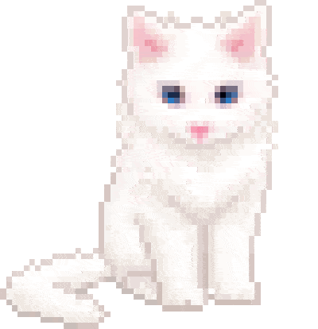
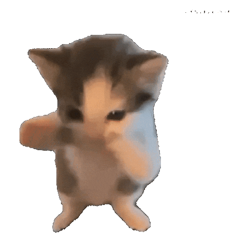

# Renan Scavazzini

### Estatístico | Cientista de Dados

Trabalho com modelagem estatística, Machine Learning e soluções analíticas, da preparação dos dados à aplicação dos resultados.

[LinkedIn](https://www.linkedin.com/in/renan-scavazzini/) · [Repositórios](https://github.com/RenanScavazzini?tab=repositories)

---

## Sobre

Sou formado em Estatística pela Universidade Estadual de Maringá (UEM) e trabalho com Ciência de Dados. Meu foco é unir método estatístico e entrega prática: estruturar bases, construir atributos, desenvolver modelos, validar resultados fora do período de treino e transformar scores em decisões operacionais.

Em risco de crédito, isso aparece no ciclo completo de modelagem e na construção de uma política de crédito. Também desenvolvo ferramentas analíticas para explorar dados do dia a dia, como gastos, produtos e histórico de preços.

Fora do trabalho, gosto de anime, viagens e, claro, gatos.

🐈 Pausa para a equipe felina (10 GIFs)

 

  
  
  
  
  
   
  
  
  
  
  

## Projetos em destaque

### [Credit Risk Case](https://github.com/RenanScavazzini/case_datarisk)

Pipeline de risco de crédito de ponta a ponta: definição da população e do target, engenharia e seleção de atributos, comparação de modelos, validação temporal e política de crédito. O modelo final é LightGBM, selecionado pelo KS na base OOT.

**Python · Pandas · LightGBM · Modelagem de risco**

### [Model Supermarket](https://github.com/RenanScavazzini/model_supermarket)

Dashboard para analisar notas fiscais, acompanhar gastos e preços ao longo do tempo, comparar supermercados e explorar produtos. Inclui enriquecimento com dados climáticos.

**Python · Streamlit · Pandas · Plotly · Estatística**

### [Instagram Analytics](https://github.com/RenanScavazzini/model_instagram)

Pipeline em camadas para tratar exportações do Instagram, acompanhar eventos e snapshots e apresentar métricas disponíveis em um dashboard.

**Python · Pandas · Parquet · Análise temporal**

## Ferramentas

- **Modelagem:** Python, Pandas, scikit-learn, LightGBM
- **Dados:** SQL, PySpark, Databricks, SAS
- **Análise e visualização:** Power BI, Streamlit, Plotly
- **Desenvolvimento:** Git

## GitHub

  

  <picture>
    <source media="(prefers-color-scheme: dark)" srcset="https://raw.githubusercontent.com/RenanScavazzini/RenanScavazzini/output/github-contribution-grid-snake-dark.svg">
    <source media="(prefers-color-scheme: light)" srcset="https://raw.githubusercontent.com/RenanScavazzini/RenanScavazzini/output/github-contribution-grid-snake.svg">
    
  </picture>

Para conversar sobre modelagem de risco, analytics ou projetos de dados, [me encontre no LinkedIn](https://www.linkedin.com/in/renan-scavazzini/).

