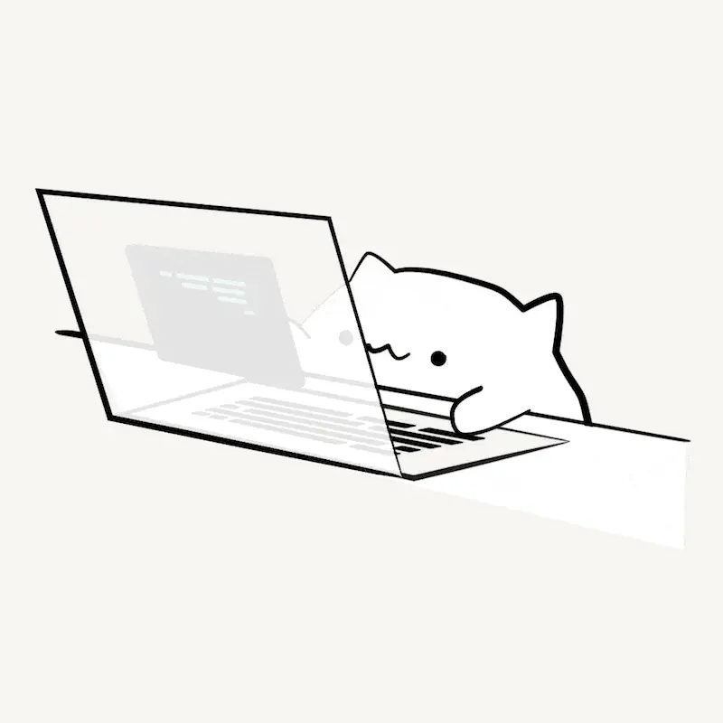

<h1 align="center">Oii, eu sou o Renan! 🐾</h1>

  <strong>Estatístico · Cientista de Dados · Entusiasta de Machine Learning</strong> 
  Transformando dados em decisões — com uma ajudinha dos gatos. 🧡

  

Dois momentos, usando exatamente as imagens originais 🐾

  
  
  

---

## 🌷 Sobre mim

- 🎓 **Estatística** pela Universidade Estadual de Maringá (UEM).
- 📊 Trabalho com **Ciência de Dados, modelagem estatística e Machine Learning**.
- 🧠 Gosto de transformar problemas de negócio em soluções orientadas por dados.
- 🛠️ Tenho experiência com preparação de dados, engenharia de atributos, desenvolvimento e acompanhamento de modelos.
- 🐈 Fora do código, provavelmente estou com meus gatos, vendo anime ou planejando a próxima viagem.

## 🧰 Minha caixinha de ferramentas

  
  
  
  
  
  
  
  
  

## 💻 Projetos em destaque

<table>
  <tr>
    <td width="50%" valign="top">
      <h3>🎯 <a href="https://github.com/RenanScavazzini/case_datarisk">Credit Risk Case</a></h3>
      
Pipeline de modelagem de risco de crédito para estimar a probabilidade de inadimplência, da construção da população à política de crédito.

      
Python · Pandas · Machine Learning · Modelagem de risco

    </td>
    <td width="50%" valign="top">
      <h3>🛒 <a href="https://github.com/RenanScavazzini/model_supermarket">Model Supermarket</a></h3>
      
Dashboard analítico de notas fiscais de supermercados, com indicadores, análises temporais, histórico de preços e exploração de produtos.

      
Python · Pandas · Streamlit · Plotly · Estatística

    </td>
  </tr>
  <tr>
    <td width="50%" valign="top">
      <h3>🧱 <a href="https://github.com/RenanScavazzini/estudo_databricks">Estudos Databricks</a></h3>
      
Espaço para estudos e experimentos com a plataforma Databricks e seu ecossistema de dados.

      
Databricks · Spark · PySpark

    </td>
    <td width="50%" valign="top">
      <h3>✨ Mais projetos</h3>
      
Explore meus repositórios públicos para acompanhar outros experimentos, estudos e ideias em desenvolvimento.

      
<a href="https://github.com/RenanScavazzini?tab=repositories">Ver todos os repositórios →</a>

    </td>
  </tr>
</table>

## 📊 Estatísticas e Atividade no GitHub

  
  

  

  

  

  

## 🐍 Snake animation

  <em>A cobrinha passeia pelo meu histórico de contribuições — e vai sendo atualizada automaticamente todos os dias.</em>

  <picture>
    <source media="(prefers-color-scheme: dark)" srcset="https://raw.githubusercontent.com/RenanScavazzini/RenanScavazzini/output/github-contribution-grid-snake-dark.svg">
    <source media="(prefers-color-scheme: light)" srcset="https://raw.githubusercontent.com/RenanScavazzini/RenanScavazzini/output/github-contribution-grid-snake.svg">
    
  </picture>

---

  <em>Feito com ☕, curiosidade e supervisão felina.</em> 
  “There is no bug — the cat just changed the requirements.” 🐈

